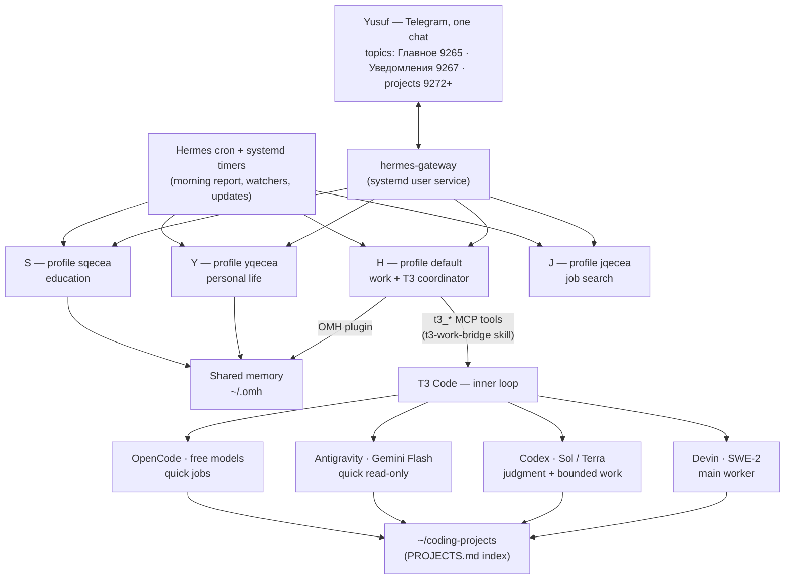

# hermes-pro — the OS of Yusuf's agent setup

One person, one Telegram chat, four Hermes profiles and a fleet of coding
harnesses behind them. This repository is the map and the checks for that
setup. It is **not executed**: the live system runs from `~/.hermes`,
`~/.agents`, `~/.codex`, `~/.claude` and `~/coding-projects`. Think of this
repo the way open-swe describes an agent harness — except it documents a
whole personal operating system.

Коротко по-русски: это карта и проверки сетапа, а не его код. Живой сетап —
в `~/.hermes` и `~/coding-projects`. За 10 минут: эта схема → `SETUP-MAP.md`
(сгенерировано из живых конфигов) → `docs/`.

Public mirror: [oysana/hermes-os](https://github.com/oysana/hermes-os) —
squashed snapshots of this tree without internal files or history, exported
by `scripts/export-public.sh` (the private repo's history contains personal
data and stays private).

## Read in this order

1. **[SETUP-MAP.md](SETUP-MAP.md)** — generated from the live configs
   (`scripts/setup-map.py --write`): profiles, models, plugins, enabled
   cron jobs, Telegram topics. Regenerate instead of editing.
2. **[docs/](docs/)** — one page per layer: [profiles](docs/profiles.md),
   [task routing](docs/routing.md), [models and T3 seats](docs/models.md),
   [memory](docs/memory.md), [schedules](docs/schedules.md),
   [boundaries and security](docs/boundaries.md),
   [adding a project](docs/projects.md),
   [setup as code](docs/setup-as-code.md).
3. **[AGENTS.md](AGENTS.md)** — the map for agents working inside this
   setup: where things live, which commands, what is forbidden.

## What lives in this repo

| Path | Role |
|---|---|
| `scripts/` | The check suite entry (`check.sh`) plus the few scripts the live setup calls (`morning-diff-report.py`, `verify-quota-outcome.py`, `setup-map.py`) |
| `setup/` | Source of truth for the live setup: `manifest.tsv` + `home/` mirror. Changes reach live only via `scripts/setup-apply.sh` (lock + backup + verify + rollback); drift is caught by `setup-sync.py drift` |
| `tests/` | Lanes invoked by `scripts/check.sh` — contract tests against the live configuration |
| `runtime/` | Manifests and fixtures the tests pin (installed-file manifests, repair records) |
| `verification/` | Bend 2 law proofs for critical invariants |
| `research/` | Live fixtures (`post-receipts.jsonl`, `x-posts-20261112/`) and cited sources |
| `.github/workflows/check.yml` | `canonical-check` on a self-hosted runner on this machine |
| `CURRENT_WORK.md`, `PLAN.md` | Internal coordination record — private working repo only, excluded from the public mirror |

## Boundaries

- Never run git on `/home/yqecea`.
- Never read `.env`, `~/.hermes/auth.json`, tokens or real message bodies.
- An owner-facing message goes only to the owner's own chat or topic.
- Full list: [docs/boundaries.md](docs/boundaries.md).
